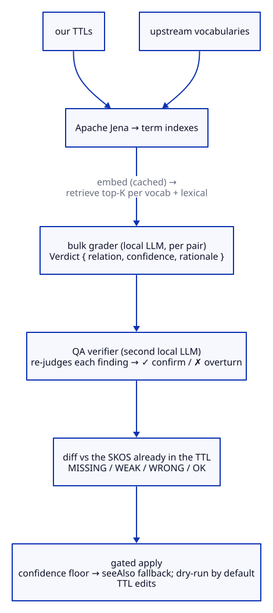

# The vocab-sync AI pipeline

How `vocab-sync` uses language models to propose and verify graded-SKOS mappings from the
OpenEPCIS DPP-extension ontology to upstream vocabularies, and what we learned measuring it.

**The whole chain runs locally.** Bulk grading, QA verification, and embeddings are all served
by [LM Studio](https://lmstudio.ai/)'s OpenAI-compatible endpoint on the workstation. No term
data leaves the machine, there is no API key, and a full run costs nothing but local compute.
A hosted model can be slotted into the QA stage by repointing the OpenAI-compatible endpoint
(`QA_BASE_URL`/`QA_CHAT_MODEL`), but the measurements below show it adds no accuracy over the
local model, so staying local is the recommendation.

## The stages

<!-- Diagram source: diagrams/ai-pipeline.d2 — regenerate with `pnpm run diagrams:build`, do not edit the SVGs. -->
<picture>
  <source media="(prefers-color-scheme: dark)" srcset="diagrams/ai-pipeline-dark.svg">
  
</picture>

1. **Index** (`OurIndex`, `UpstreamIndex`, Apache Jena). Both our ontology and the upstream
   vocabularies are parsed into typed term records. Every IRI a mapping is proposed against must
   exist in the upstream index — the first anti-hallucination guard, re-checked at apply time.
2. **Retrieve** (`Embeddings`, `Retriever`). Each term is embedded once (vectors cached on disk
   by `(embed-model, text)`), then the top-K nearest upstream terms *per vocabulary* are gathered,
   plus exact local-name matches. Type is enforced: a class only pairs with a class, a property
   with a property.
3. **Bulk grade** (`Grader`, a `@RegisterAiService`). One pair at a time, the model returns the
   single best graded-SKOS relation (`EXACT` / `CLOSE` / `BROAD` / `NARROW` / `NONE`) with a
   self-reported confidence and a one-sentence rationale. Verdicts are cached by
   `(model, ourIri, upstreamIri)`, so re-runs are reproducible and a long run resumes after an
   interruption.
4. **QA verify — a blind, multi-judge panel with a two-tier gate** (`QaGrader.judgeBlind`,
   `AuditCommand.reconcile`). A stronger model judges each finding under `--qa-judges` (default 3)
   decorrelated *lenses* (definition-scope, subsumption-direction, strict-skeptic), **blind** — none
   of them sees the bulk proposal, so they cannot anchor on it. Their votes reconcile against the
   bulk relation into a tier: **STRONG** (strict majority equals the bulk relation → write that
   relation), **WEAK** (majority is a different non-NONE relation → existence agreed but not the
   grade → write `skos:closeMatch`), **REJECT** (majority NONE → drop), **SPLIT** (no majority →
   leave for human review). This is the real quality gate. It exploits the benchmark's key
   asymmetry — "is there a relation?" is reliable, "which graded relation?" is not — so a
   grade-uncertain pair is salvaged as a safe `closeMatch` instead of discarded.
5. **Diff & classify.** Each graded pair is compared with the SKOS already in the TTL and labelled
   MISSING / WEAK / WRONG / OK.
6. **Gated apply.** Dry-run by default. Below the confidence floor an add is emitted as
   `rdfs:seeAlso` rather than a graded `skos:*Match`; output is re-parsed and restored on invalid
   edits. The canonical TTLs are never auto-edited without `--apply`.

Concurrency is Mutiny throughout (`Multi … transformToUni(…).merge(N)` bounds in-flight requests;
the blocking AiService call runs on the Vert.x worker pool with backoff retry).

## Models

Since 2026-11 the measured best setup is hosted: Claude Opus 5.5 through the Anthropic Message
Batches API, at half the synchronous price with the shared rubric prompt-cached (see
[2026-11](#2026-11-the-ceiling-was-the-rubric-not-the-model)). The local chain still runs end to
end with no API key and stays the fallback.

| Role | Recommended | Local fallback | Why |
|---|---|---|---|
| Bulk grader | `--batch-model claude-sonnet-5-5` (or `claude-opus-5-5`) | `qwen3.8-27b`, reasoning off | Sonnet 85.6 %, Opus 88.9 % on the EU gold set; `qwen3.8-27b` 73.3 % at 3.5 s per pair. The grader only pre-sorts; the panel decides. |
| QA panel | `--qa-batch-model claude-opus-5-5` | `qwen3.8-27b`, `--reasoning-effort medium` | The panel decides what is published, so it gets the strongest model: Opus is first on every gold set that measures the real task. Locally `qwen3.8-27b` with reasoning reaches 76.7 %, one point behind Haiku 5.5, at 34 s per pair. |
| Embeddings | `nomic-embed-text` (local) | same | Retrieval only; cached per model so vector spaces never mix. |

Repoint the local roles with env vars (`LLM_BASE_URL` / `LLM_CHAT_MODEL` / `LLM_EMBED_MODEL`, and
the `QA_*` set for the verifier). Defaults target LM Studio on `localhost:1234`.

## The confidence floor is volume control, not quality control

The floor (default 0.75) decides one thing: assert a graded `skos:*Match`, or fall back to a
non-committal `rdfs:seeAlso`. The benchmark showed the bulk grader's self-reported confidence
**does not track which graded relation is correct** — exact-relation accuracy is flat (~50%) from
confidence 0.75 to 0.90. What *is* near-certain at any confidence is that *some* relation exists
(~99% of asserted pairs map to a real gold relation). So:

- Keep the floor around **0.75–0.80** to trim the low-confidence tail; raising it does **not** buy
  better grades.
- The `rdfs:seeAlso` fallback below the floor is correct: it keeps the trustworthy "these are
  related" signal and withholds only the unreliable precise grade.
- **The QA pass, not the floor, polices graded-relation correctness.** Adopt confirmed (`✓`)
  findings; scrutinise overturned (`✗`) ones.

## What we measured: what made sense, what didn't

We picked the grader and the floor by measurement, not intuition: a balanced 200-pair gold set
built from a published, human-curated graded-SKOS concordance (STW ↔ Wikidata), every model judged
with the identical production prompt at temperature 0. Full leaderboard, confusion matrices, and
calibration: [`docs/skos-alignment/bench/skos-grader-benchmark.{md,json}`](../../../docs/skos-alignment/bench/skos-grader-benchmark.md);
gold set and raw predictions are alongside it.

**What made sense:**

- **The local bulk grader is enough.** `gpt-oss-20b` scored 52.0% exact-relation accuracy, level
  with Claude Opus's 52.5%, at **5.6× the speed** (1.4 s vs 7.9 s per pair) and zero parse failures.
  The cheap local model was the right default all along.
- **Detecting *whether* a relation exists is reliable** (NONE recall 96%; "a mapping exists" ~99%
  among asserted pairs). The pipeline can trust the existence signal even when it cannot trust the
  exact grade.

  > **This does not hold on near misses (2026-08).** The 96% is measured against STW negatives,
  > which are far apart and rejected trivially. Scored against 24 pairs this project's own curators
  > proposed and then REMOVED, the same models accept 58% to 92% of them. The existence signal is
  > reliable about unrelated things and unreliable exactly where a curator's time goes.
  >
  > `devstral-small-2-2512` is the cautionary case, and the trap is visible in the table above:
  > 95.5% match/no-match on STW made it look like the best possible gatekeeper, and it discarded
  > only 4% of real mappings — because it barely discards anything at all. On the domain gold set it
  > accepts 92% of curator-rejected pairs and scores 22% overall. A high match/no-match figure on
  > easy negatives does not predict gate quality; it can invert the ranking. Do not choose a
  > gatekeeper on that column.
- **Precision beats size.** The same `Qwen3-32B` weights at 8-bit beat their own 4-bit by **+4
  points** and reached the ceiling; an 8-bit 32B beat a 4-bit 122B by six points. For semantic
  judgement, run the highest precision that fits rather than the largest model.
- **A second, independent model as QA** is the lever that actually improves output quality, since
  the confidence number does not.

**What didn't:**

- **Opus adds no benefit** (under the original rubric; superseded 2026-11, see below). Its 52.5% is statistically indistinguishable from the local 52.0–52.5%,
  so a hosted QA pass buys no accuracy — only an external dependency, a cost, and data leaving the
  machine. Its only marginal value is model-family independence, which an all-local pair already
  provides. Keep it available, default to local.
- **Bigger-at-4-bit didn't help.** The 4-bit 122B (46.5%) landed *below* the 20B and 32B models,
  partly from a 15% parse-failure rate. Raw parameter count at low precision is a poor trade.
- **Reasoning-tuned models didn't pay off.** `magistral` and `phi-4-mini-reasoning` sat near the
  bottom and carried the worst parse-failure rates: at a sane token budget they spend it "thinking"
  and get cut off before emitting clean JSON. Raising `phi-4-mini`'s cap to 16k moved accuracy only
  +2.5 points (and most residual failures were empty/runaway output, not truncation) at double the
  latency. They convert latency into deliberation the task does not reward.
- **Code-tuned models are weak graders** (`qwen3-coder-next` 40.5%), as expected for the negative
  controls — fine at deciding match/no-match, poor at the graded relation.
- **Confidence is not a quality dial** (see the floor section) — the single most useful negative
  result, because it redirects trust from the floor to the QA pass.
- **The task has a real ceiling (~52%), and no model choice raises it.** Every model, Opus included,
  tops out there because the graded distinction is intrinsically fuzzy: `CLOSE` is the hardest class
  (23% recall — it overlaps EXACT, NARROW, and NONE), and `BROAD` is most often misread as `NONE`
  (models miss that one concept subsumes another). The lever that moves this is upstream of the
  model — richer term context in the prompt and human review of the CLOSE/BROAD proposals the QA
  pass flags — not a bigger model.

## Running it regularly (the `sync` loop)

The alignment is meant to be re-run whenever an upstream vocabulary moves. The `sync` command is the
single entry point for that, and it is designed to be cheap enough to schedule:

```bash
# pull every configured upstream → re-grade only what changed → apply QA-confirmed to a branch
java -jar target/quarkus-app/quarkus-run.jar sync --stamp 2026-06-25
```

What it does, in order:

1. **Refresh upstream.** Downloads each configured source (`vocab-sync.source.<vocab>.url` in
   `application.properties`), diffs it against the cache, and writes `docs/skos-alignment/skos-upstream-delta.json`.
   `fetch --all` runs just this step. Sources with no URL configured are skipped; schema.org has a
   working default. (gzip responses are inflated automatically.)
2. **Gate.** If nothing moved, `sync` stops — no audit, no LLM calls, no branch. `--force` overrides.
3. **Audit only what changed.** This is the runtime keystone: the verdict cache is keyed by a
   **content fingerprint** of both terms, not just their IRIs, so a re-run re-grades exactly the
   pairs whose label/definition moved (plus brand-new candidates) and serves every unchanged pair
   from cache. A regular run therefore costs a handful of LLM calls, not a full re-grade — and it is
   *correct*, where an IRI-only cache would have served a stale verdict for an edited definition.
4. **Apply to a branch.** Confirmed (`✓`) mappings at/above `--min-qa-confidence` (default 0.75) are
   applied to a fresh `vocab-sync/upstream-<stamp>` branch via the gated `apply` (dry-run-then-write
   with the reparse safety net), `provenance` is regenerated, and it commits — **never on the current
   branch, never pushed** (unless `--push`). The current branch's TTLs are untouched. `--no-apply`
   stops at the report. A dirty working tree disables auto-apply (so unrelated edits are never swept
   into the commit); a scheduled run sees a clean tree.

**Scheduling.** `ops/sync.sh` is a fail-soft wrapper (it forces JDK 25, checks the LLM endpoint is up
and exits cleanly if LM Studio is closed, logs to `.cache/sync.log`). `ops/com.openepcis.vocab-sync.plist`
is a launchd template (weekly) — edit the path and `launchctl load` it. A cron equivalent:
`0 9 * * 1 /…/tools/vocab-sync/ops/sync.sh`. Because the whole chain is local, the schedule runs on
this machine and only does work when LM Studio is running.

### Runtime notes

- **Warm runs are ~free.** Embeddings (`SHA256(model|text)`) and verdicts (now content-fingerprinted)
  are cached on disk; an unchanged pair is a cache hit. The cost is grading the changed/new set.
- **Grading concurrency** defaults to 2 because langchain4j's JDK HttpClient negotiates HTTP/2 to LM
  Studio and stalls under sustained parallelism (the benchmark hit the same wall and pinned HTTP/1.1).
  Pinning HTTP/1.1 on the grading path (a `dev.langchain4j.http.client.HttpClientBuilderFactory`
  that sets `HttpClient.Builder.version(HTTP_1_1)`) would let `--concurrency` rise toward LM Studio's
  parallel slots (gpt-oss-20b loads with 4). With the content-aware cache keeping changed-sets small,
  this rarely matters in a regular run, so it is documented here as a ready lever rather than applied.
- **One-time:** changing the verdict-cache key format orphans old entries (harmless); the first run
  after the change re-grades, then steady state resumes.

## 2026-11: the ceiling was the rubric, not the model

The ~52 % ceiling above held for every model under the original rubric. Four things changed on
2026-11-06, and the ceiling moved by more than thirty points.

**A gold set that measures the real task.** `docs/skos-alignment/bench/eu-dpp-goldset.json` holds
90 pairs from the hand curation against the EU DPP Registry: the mappings that were written, each
checked against the legal source of the EU data element, and the declines with a stated reason.
It carries what the production grader sees (prefixed id, type, domain, range, the EU scope note
with the legal source, the element's parent group) and a dev/test split from a hash of the pair
id, so adding pairs never moves an existing one. Built by `tools/build-eu-goldset.py`.

The 117 pairs decided in the model-assisted adjudication of 2026-11-06 are a second file,
`eu-dpp-adjudicated.json`. The same models graded them, so they check consistency, not accuracy,
and they never enter the headline leaderboard.

The GS1 domain gold set is circular for model choice: its positives are mappings the `gpt-oss`
pipeline proposed, so it rewards agreement with `gpt-oss`. Its 21 pairs that all four Claude 5
models reject are mostly wrong mappings (packaging terms for product terms, generic value slots,
`eoriNumber` against a regulatory record reference). Use it to find mappings worth re-reading, not
to rank graders.

**A curator rubric** (`GraderPrompts.RUBRIC`, version `curator-5`), shared by the grader and the QA
panel. The original rubric said "when uncertain between two grades, choose the weaker one", and
that rule produced most of the errors: a model saw our structured value against the EU's literal
or web link and downgraded the same data point to CLOSE. The curator rubric judges the data point,
not its representation; the same data point is EXACT even when the scope differs in a minor way
(the project's curation policy since 2026-11-06); one value of a bundled data point is NARROW; and
it lists the cases a curator never publishes (structural grouping, threshold versus measured value,
rated versus measured, type versus thing, flag versus list, different referent). Serialisation
slots (`url`, `value`, `unit`, ...) are not left to the model at all: no model kept to that rule
from the prompt (2 to 12 % on 51 slot pairs), so `PairJudge` returns NONE for them before grading.

**Element context.** The EU DPP Registry copies the legal text of a whole provision onto every
element it splits into (`serialNumber`, `productNumber` and `otherIdentificationElement` all carry
the definition of Annex VI Part A 2). Every model then read "Serial number" as the whole provision.
`UpstreamIndex` now names the parent group and says when a definition is shared with siblings, and
the rubric says the label names the element in that case.

**Thinking.** The Claude 5 models think by default. A local model with reasoning off answers in a
second but loses ten points; with reasoning at `medium` it closes most of the gap to Haiku.

EU DPP Registry gold set, 90 pairs, same prompt for every model (graded relation; in brackets
whether a mapping exists at all):

| Model | original rubric | curator-5 |
|---|--:|--:|
| claude-opus-5-5 | 52.2 % | **88.9 %** (97.8 %) |
| claude-sonnet-5-5 | 56.7 % | 85.6 % (93.3 %) |
| claude-fable-5-1 | 61.1 % | 82.2 % (93.3 %) |
| claude-haiku-5-5 | 38.9 % | 77.8 % (92.2 %) |
| qwen3.8-27b, reasoning medium | | 76.7 % (91.1 %), 34 s per pair |
| qwen3.6-35b-a3b, reasoning medium | | 75.6 % (88.9 %), 16.6 s per pair |
| qwen3.8-27b, reasoning off | | 73.3 % (87.8 %), 3.5 s per pair |
| gpt-oss-120b, reasoning medium | | 72.2 % (85.6 %), 5.5 s per pair |
| qwen3.6-35b-a3b, reasoning off | | 65.6 % (82.2 %), 0.9 s per pair |
| gpt-oss-20b, reasoning off | 46.7 % | 60.0 % (81.1 %), 1.1 s per pair |
| gpt-oss-120b, reasoning off | | 60.0 % (78.9 %), 10 % parse failures |

The original-rubric column comes from the scratch harness of the same day (same pairs and fields);
the curator-5 column is `benchmark` on this tool, the Anthropic rows through `--batch`. The gold
labels follow the 2026-11-06 curation, which raised seven CLOSE mappings to EXACT under the
same-data-point policy.

The curator rubric does not cost the general task anything. On the STW ↔ Wikidata set, which has
no data points and no legal sources, the models stay within noise of their old scores (Opus 5.5
56.0 %, Sonnet 5.5 56.0 %, Fable 5.1 56.5 %), and whether a mapping exists at all rises (Sonnet
82.0 % to 87.5 %).

What the remaining errors are: pairs where a reasonable curator could go either way, and the
power-capability group, where the models were right and the curation was not: our
`hasPowerCapabilityAt80SoC` is defined as the current value and sat under the EU *original*
power capability. That mapping is corrected.

What follows for the pipeline:

- Opus 5.5 is the grader and panel to use when the result is published. Its lead over the
  best local model is 13 points on the graded relation and 9 on whether a mapping exists.
- The rubric matters as much as the model. It lifted the local models by 13 to 15 points too.
- Local reasoning pays, at a cost in time: `qwen3.8-27b` at `--reasoning-effort medium` is the
  best local model measured (76.7 %), one point behind Haiku 5.5. With reasoning off it keeps
  73.3 % at a tenth of the time, which makes it the local bulk grader.
- The way back to a local-only pipeline at the same quality is the Opus-checked verdicts the audits
  now produce: they are the examples and training data a local grader needs.
- The rubric version is part of every verdict's cache key, so a rubric change re-grades instead of
  serving verdicts the old rubric produced.

## Reproduce the benchmark

```bash
# fully local; discovers loaded models, or pass --models
java -jar target/quarkus-app/quarkus-run.jar benchmark --per-class 40

# the EU DPP Registry gold set on Anthropic models through the Message Batches API
java -jar target/quarkus-app/quarkus-run.jar benchmark --batch \
  --goldset docs/skos-alignment/bench/eu-dpp-goldset.json \
  --out docs/skos-alignment/bench/eu-dpp-grader-benchmark \
  --models claude-opus-5-5,claude-sonnet-5-5,claude-haiku-5-5

# a local model with reasoning on, as its own leaderboard row
java -jar target/quarkus-app/quarkus-run.jar benchmark \
  --goldset docs/skos-alignment/bench/eu-dpp-goldset.json \
  --out docs/skos-alignment/bench/eu-dpp-grader-benchmark \
  --models qwen/qwen3.8-27b --reasoning-effort medium --max-tokens 16384 --tag " think-medium"
```

Same gold set + temperature 0 reproduces the numbers; a partial run resumes from the appended
`predictions.jsonl`. The `benchmark-manifest.json` records models, parameters, prompt identity,
and hardware.
